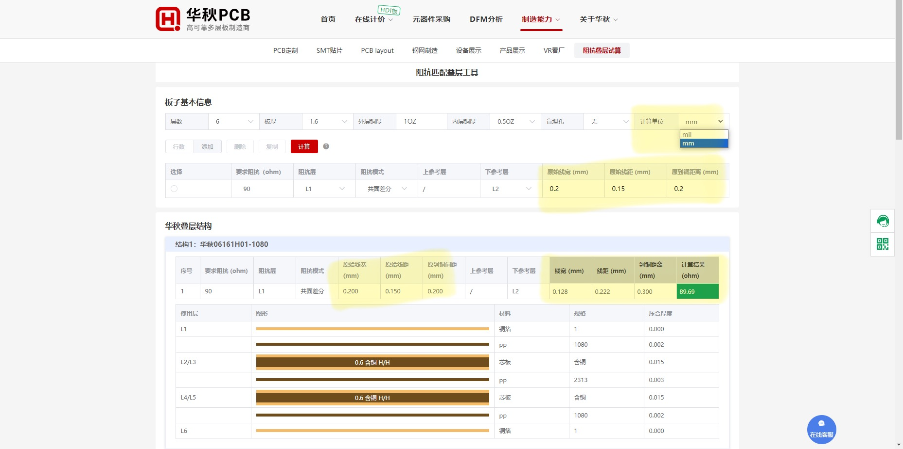

> [!WARNING]
> 因为作者不再使用该网站，自 `2026 年 8 月 25 日` (`v1.1`) 起归档，不再维护。请注意，随着网站的更新，可能会存在兼容性问题。

    
    <h1>HqPCB-毫米计算阻抗 <code>v1.1</code></h1>
	

        
	    
    

## 简介

华秋PCB阻抗计算页面本来只有mil，添加单位选择，可以切换到mm。

